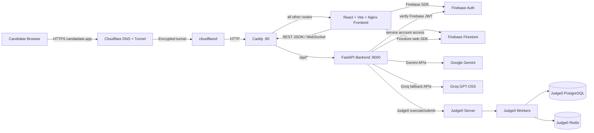
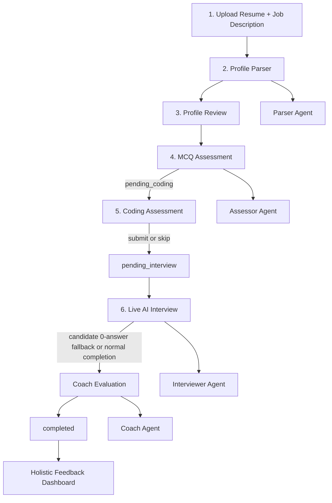
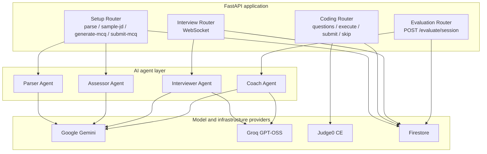
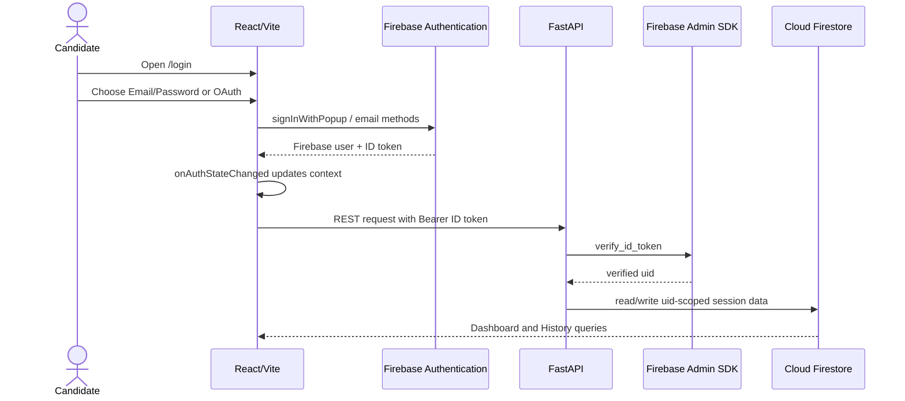
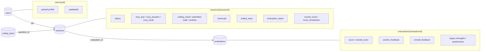
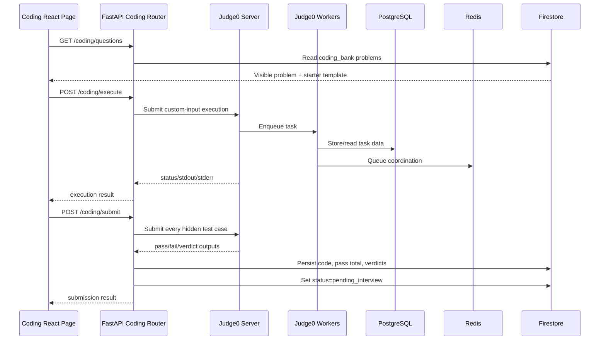
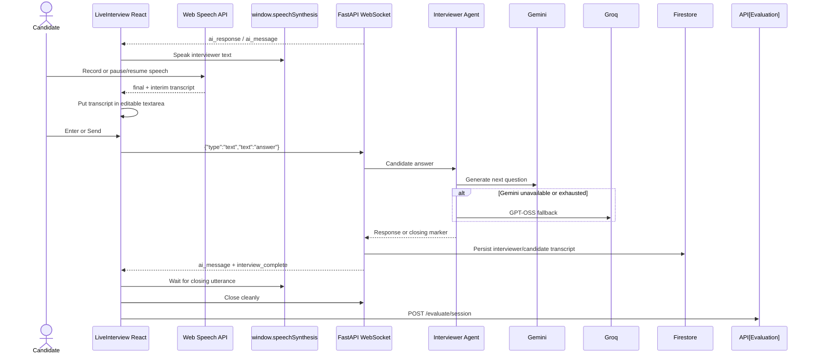
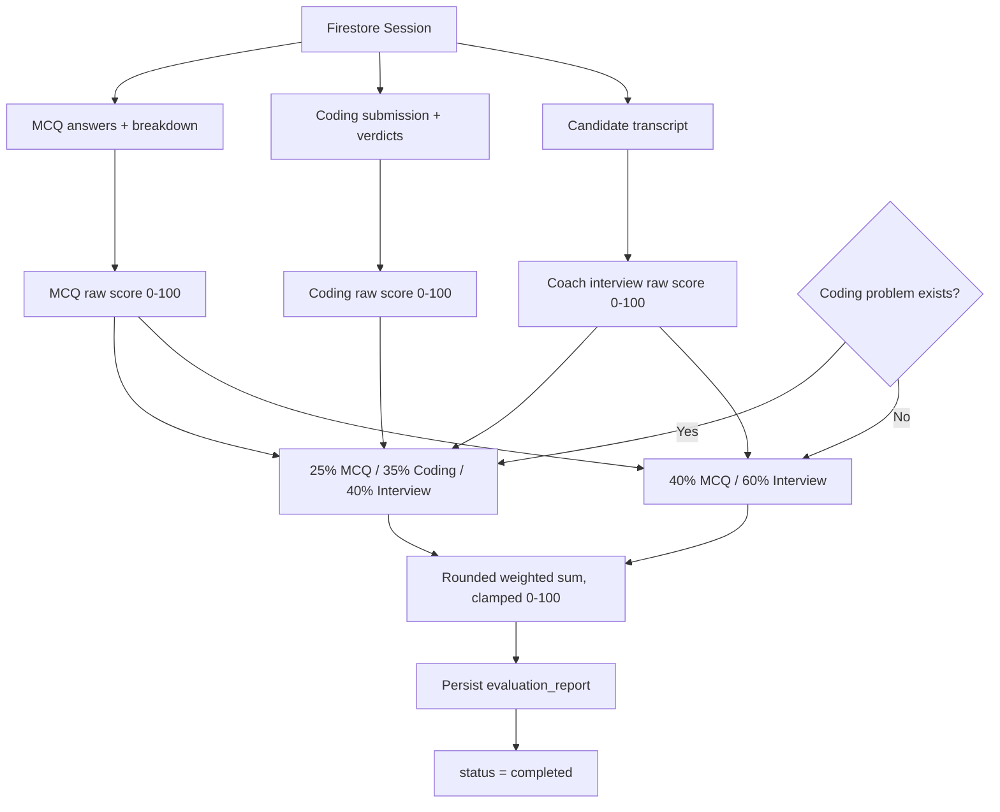
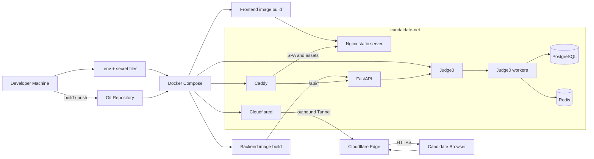
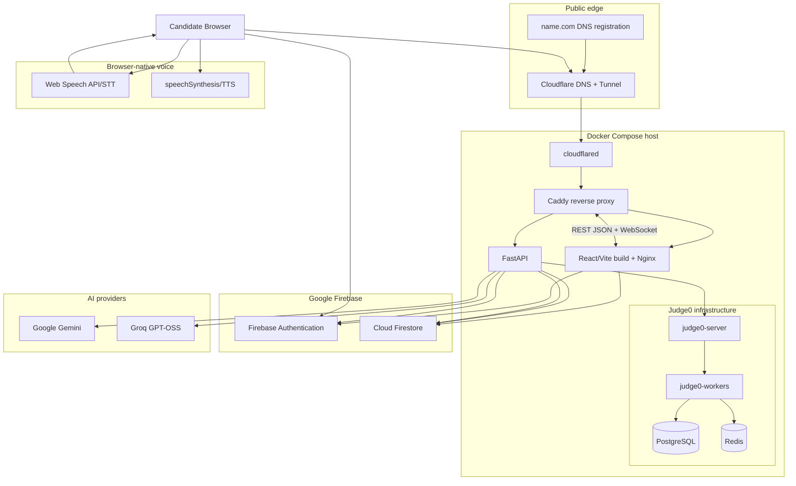

# candAIdate System Architecture

This document describes the current production architecture for the
candAIdate AI interview platform. It covers the complete candidate workflow,
Docker deployment, agent orchestration, Firebase/Firestore integration,
Judge0 coding execution, live voice behavior, evaluation, and Cloudflare
public ingress.

## 1. Current Production Stack



## 2. Six-Step Agentic Candidate Flow



The persisted session state is:

```text
pending_assessment
  -> pending_coding
  -> pending_interview
  -> completed
```

## 3. Agent Architecture



### Parser Agent

The Parser Agent:

- Accepts PDF, DOCX, or TXT resume content.
- Reads the target job description.
- Produces a structured candidate profile.
- Persists the profile through `app/core/db.py`.

### Assessor Agent

The Assessor Agent:

- Uses the parsed profile.
- Generates the pre-screen MCQ set.
- Persists quiz questions in the Firestore session.

### Interviewer Agent

The Interviewer Agent:

- Maintains the conversation history.
- Uses the Gemini model chain first.
- Falls back to Groq for provider failures.
- Appends `[INTERVIEW_COMPLETE]` when closing.
- Uses a server-side candidate-answer cap of 7 turns.

### Coach Agent

The Coach Agent:

- Reads the live transcript.
- Reads MCQ accuracy and breakdown.
- Reads coding pass rate and submitted verdicts.
- Produces section feedback and final overall feedback.
- Uses a deterministic fallback if the LLM fails or the interview has zero
  candidate answers.

## 4. Authentication and Firebase Integration



Supported popup providers:

- Google
- GitHub
- Microsoft

OAuth providers require:

- Authorized domains: `localhost` and `candaidate.app`
- Google/GitHub/Microsoft providers enabled
- Provider OAuth credentials
- Firebase callback:
  `https://<firebase-project-id>.firebaseapp.com/__/auth/handler`

The frontend uses `same-origin-allow-popups` so Firebase popup polling remains
usable on the custom production domain.

## 5. Firestore Data Model



Firestore session status values:

```text
pending_assessment
pending_coding
pending_interview
ready_for_evaluation
in_progress
completed
cancelled
```

## 6. Judge0 Coding Pipeline



## 7. Live Voice Interview Architecture



The STT state machine is:

```text
idle -> recording -> paused -> recording
idle <- stop
paused -> idle
```

The STT implementation:

- Uses final and interim Web Speech results.
- Keeps committed text separate from interim preview.
- Never sends audio automatically.
- Restarts after Chrome recognition's ~60-second auto-stop.
- Cleans up recognition listeners and timers on unmount/send/end.

Browser TTS:

- Uses `window.speechSynthesis`.
- Chooses an English voice when available.
- Supports mute, replay, and initial autoplay unlock.
- Is canceled when recording begins, a message sends, or feedback starts.

## 8. Evaluation and Weighted Scoring



Default formula:

```text
overall = round((MCQ raw × 0.25)
              + (Coding raw × 0.35)
              + (Interview raw × 0.40))
```

Legacy formula without any coding round:

```text
overall = round((MCQ raw × 0.40)
              + (Interview raw × 0.60))
```

Skipped or missing sections retain their weight and contribute `0`.

The evaluation response includes:

- `overall_score`
- legacy `score`
- `score_breakdown`
- `section_feedback`
- `overall_feedback`
- legacy `strengths`
- legacy `weaknesses`
- legacy `detailed_feedback`

The endpoint is idempotent. Completed sessions return the stored report when
possible. Empty interviews return deterministic zero-answer reports and complete
the session.

## 9. Deployment Pipeline



Cloudflare terminates public HTTPS. Caddy listens on internal HTTP port `80`.
Cloudflared uses `--protocol http2` for reliable macOS local hosting.

On macOS, keep the host awake while running local infrastructure:

```bash
caffeinate -s
```

## 10. Complete Tool and Integration Map



## 11. Security and Secret Boundaries

Browser-safe:

- Firebase web API keys
- Firebase auth domain/project values
- `VITE_API_URL`

Server-only:

- Gemini API key
- Groq API key
- Firebase service account private key
- Cloudflare tunnel token
- Judge0 credentials
- Judge0 PostgreSQL/Redis passwords

Never expose server-only credentials to `VITE_*` variables or browser network
responses.
